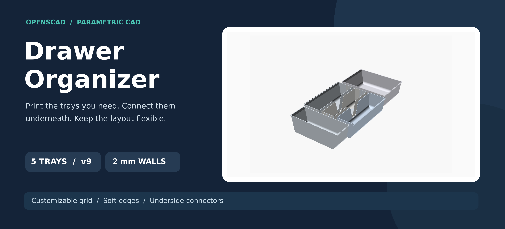
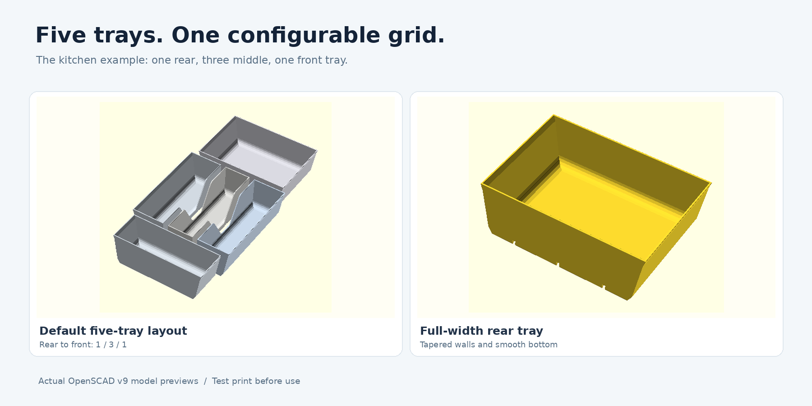
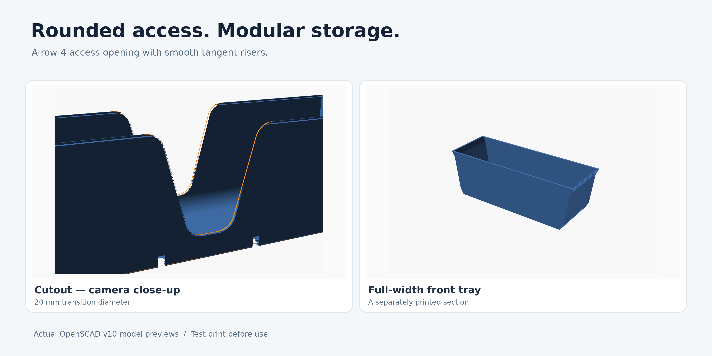
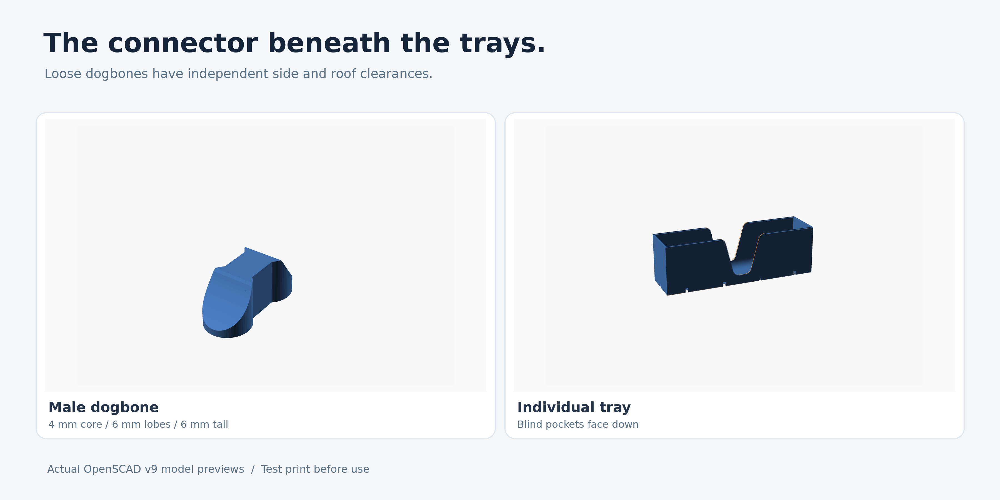

# Drawer Organizer



**Parametric · Modular · 3D-printable · OpenSCAD 2021.01**

A customizable set of kitchen-drawer trays for a measured metal-sided drawer. Print each compartment separately, then connect neighboring trays with removable dogbones inserted from underneath. The default example builds **five trays** in a **3-column × 6-row logical grid**.

**[Open the v10 model](drawer-organizer-v10.scad)** · **[Matching Customizer preset](drawer-organizer-v10.json)** · **[Development guidelines](DEVELOPMENT.md)**

> These are high-resolution, camera-fitted captures of the actual OpenSCAD model, not photographs of manufactured parts. Screenshots are resized down with antialiasing, never enlarged from crops. Always test fit and material strength on your own printer.

## See the layout



Use the **Continue previous** dropdown option to extend the preceding tray group. To request 4, 5, or 6 compartments in a row, first increase **Grid columns** to at least that number. If a row exceeds the grid size, OpenSCAD prints a helpful message and draws nothing instead of failing an assertion. In the example, rows 1–2 form the rear tray, rows 3–5 form three middle trays, and row 6 forms the front tray. Looking down into the open drawer, row 1 is at the **rear** and column 1 is on the **left**. In **Full layout preview**, the `Loose_connector_quantity` setting also shows that many separate dogbones in a single vertical column to the right of the trays. Their centers follow the Y axis with at least 4 mm between adjacent connector tips, and the column clears the outside rim and any preview separation. The selected-tray and loose-connector-only STL export modes are unchanged. Large quantities may extend beyond the layout's front/rear boundaries rather than overlap.

| Group | Trays | Approximate nominal floor footprint |
| --- | ---: | ---: |
| Rear, rows 1–2 | 1 full-width | 189 × 158 mm |
| Middle, rows 3–5 | 3 long | 63 × 237 mm per tray |
| Front, row 6 | 1 full-width | 189 × 79 mm |
| Logical grid cell | 3 columns × 6 rows | **63 × 79 mm** |

The estimated **clear** space for a logical cell is about **59 × 75 mm**, before bottom fillets. Actual space depends on the wall taper, floor corner radius, and calculated rim projection.

## Soft edges and access cutouts



The trays default to **2 mm walls and base**, **0.6 mm soft exposed-edge rounding** (also applied with a direct quarter-circle loft around the exposed access-cutout edges, without 3D Minkowski), and a shared calculated bottom interior fillet. **Inner bottom radius** is a **0–40 mm slider** (0.5 mm steps) and defaults to **0 (automatic)**. Enter a larger radius to increase the concave floor-to-wall rounding; the male dogbone and matching blind pocket both retain **more** depth toward the lobe ends as added plastic becomes available. The socket roof is calculated directly from the effective inner fillet with a normal-distance offset equal to the 2 mm base thickness; the male is trimmed using the same fillet offset by base thickness plus the 1 mm top clearance. The connector remains at most 6 mm tall and there are no interior pads. The automatic minimum also preserves a full base-thickness safety band above the exterior chamfer crest (12 mm with the default 10 mm outer chamfer rise and 2 mm base). A nonzero radius smaller than that calculated structural minimum is ignored with an OpenSCAD echo warning; minimum floor thickness and pocket roof stock are never sacrificed. A 30 mm radius can be used in a 63 mm-wide nominal tray: the two local circular fillets meet near the bottom without a 90° step, although little or no flat floor remains. The radius must fit the narrowest nominal tray span and the full lower-wall height; impossible combinations produce a descriptive echo and no geometry. The outer sidewalls taper to suit the measured drawer, while the front/rear outer ends stay vertical. The outer rim can flare outward while the inner rim follows the same slope without an extra vertical return.

One checkbox per logical row enables cutouts along interior dividers. **Row 4 is enabled** in the example. The default cutout has a **25 mm base width**, two tangent blends of **20 mm rounding diameter**, and a **75° straight riser**; the riser angle can be adjusted. The 25 mm measurement is the **unrounded base gap** where the straight risers would intersect the cutout floor *before* the 20 mm-diameter fillets are added. The rounded flat floor is narrower (about **9.6 mm** at 75°), and the top opening is about **74 mm** with the defaults. The base gap and riser angle have unrestricted numeric inputs, including zero; extreme angles are handled with a safe geometry fallback. The Customizer angle for these access notches is independent of the print-overhang angle.

### Rim angle and tray height

The **print overhang angle** and **tray height above the metal rim** are the independent rim settings. A separate rim-projection input is not needed. The model calculates horizontal projection as `height / tan(angle from the print bed)`. With the default 10 mm height and 60° angle, the selected flared edges extend approximately **5.77 mm** horizontally. The lip stays at the chosen height for all printing angles. The **drawer floor corner radius** is the only input controlling the lower exterior chamfer rise; its horizontal run is calculated from the overhang angle (for example, a 10 mm drawer radius at 60° gives 5.77 mm run and 10 mm rise). There is no separate maximum chamfer rise setting. If the required chamfer or connector-protected interior fillet does not fit, OpenSCAD explains the conflicting dimensions and renders nothing rather than silently clipping the chamfer. The cutout floor clears the inner-bottom fillet before its separate convex touch rounding is constructed.

Customizer sections and parameter labels are sentence case. Row labels are shortened to `Row_01`, `Row_02`, and so on, without duplicate explanatory text.

## Connector and tolerances



A loose dogbone inserts upward into **blind, underside-facing sockets**. There are no locking ledges or raised connector pads within the usable tray cavity.

| Setting | Default | Meaning |
| --- | ---: | --- |
| Connector center thickness | **4 mm** | Straight center width |
| Lobe protrusion | **1 mm per side** | Each circular head has **6 mm diameter** |
| Straight center span | **4 mm total** | About 2 mm inserted into each tray |
| Male connector height | **6 mm** | Maximum connector height |
| Side tolerance | **0.2 mm total** | The female socket is 0.1 mm wider on each side |
| Top tolerance | **1 mm** | Additional space between the male and blind pocket roof |

These allowances enlarge **the female pocket only**. The male retains its nominal dimensions. Both lobe ends are trimmed in height to clear the bottom interior fillet; the socket roof is kept closed in the model.

## Get started

1. Save [drawer-organizer-v10.scad](drawer-organizer-v10.scad) and [drawer-organizer-v10.json](drawer-organizer-v10.json) together.
2. Open the SCAD file in **OpenSCAD 2021.01** and select **Kitchen cutlery drawer** in the Customizer.
3. Adjust the drawer dimensions and row/column splits. Select a tray by row and column.
4. Press **F6** to render, export that tray's STL, and print. Repeat for the other trays and loose dogbones.

**Full layout** is for visual inspection, **Selected tray** exports one printable part, and **Loose dogbones** exports connectors.

## Build, test and reproduce the screenshots

Install Python 3 and OpenSCAD, then run:

```sh
python -m pip install -r requirements-dev.txt
make test
make build
make check
```

On Linux, headless PNG generation requires `xvfb` and `xauth`. The Python dependencies include `pytest`, `trimesh`, `numpy`, `scipy`, `networkx` and `Pillow`.

GitHub Actions runs the OpenSCAD geometry tests and builds the **five tray STLs, dogbone connector STL, preview PNGs and README gallery**. Download them as artifacts from the latest successful [workflow run](https://github.com/realcarbonneau/drawer-organizer-scad/actions). The four gallery images in [docs/images](docs/images) are regenerated from **3200 × 2200** OpenSCAD screenshots and exported at **3600 px** wide on successful main-branch builds. Each camera is aimed at the actual printed geometry rather than a large construction bounding box; the build rejects previews where the model is tiny or accidentally clipped.

The test suite checks mesh validity, geometry variants and connector parameters. **Real-world connector fit, wall thickness at every parameter combination and F5 orbiting speed still require manual testing.**


### Native OpenSCAD preview

The same model geometry is used in F5 and F6. There are **no** automatic `render()` calls or separate low-detail preview shapes: OpenSCAD's interface remains responsible for previewing and final rendering. The underside socket geometry is constructed as a single capped solid so the full five-tray scene can be previewed without CSG normalization overflow. F5 rotation speed still depends on your graphics driver and machine.
