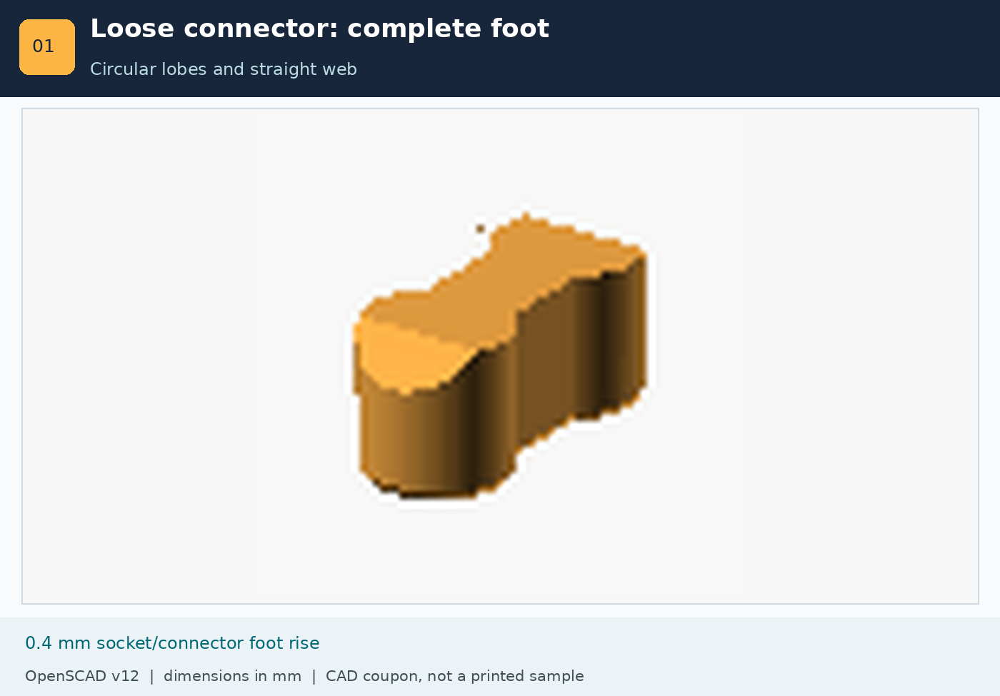
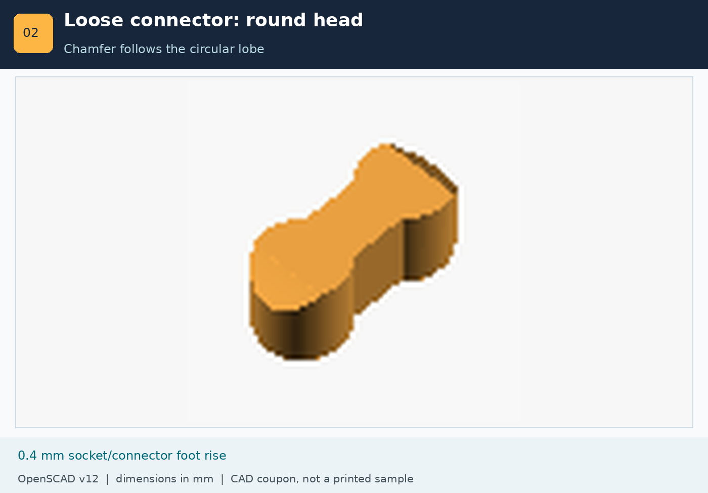
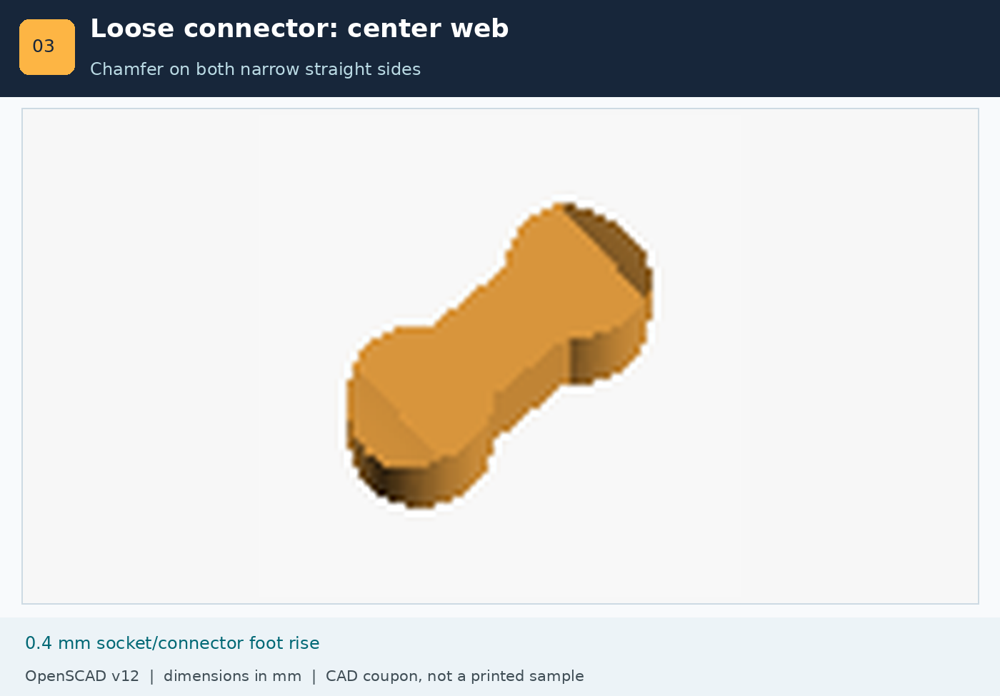
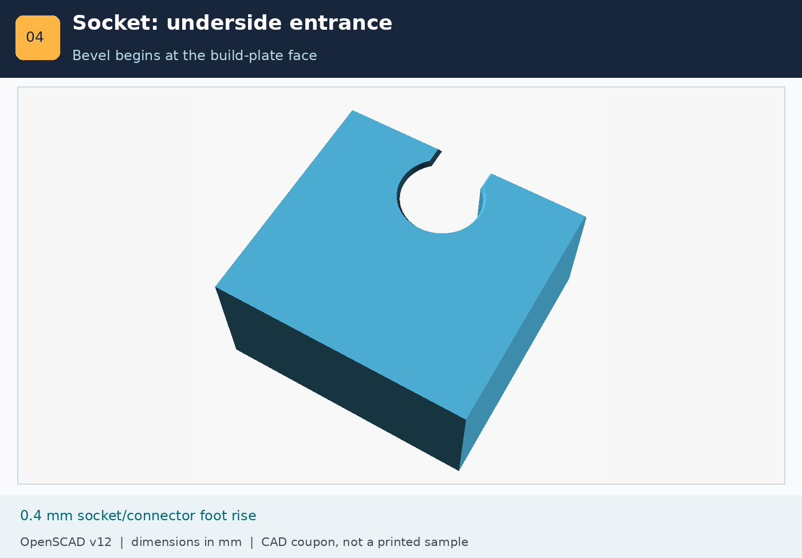
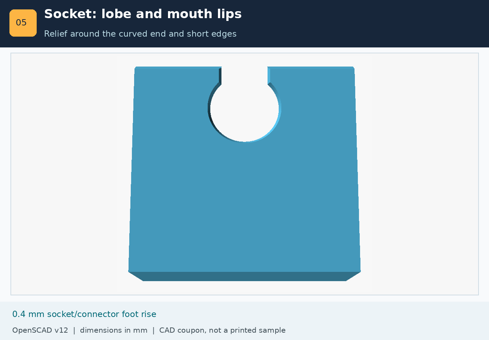
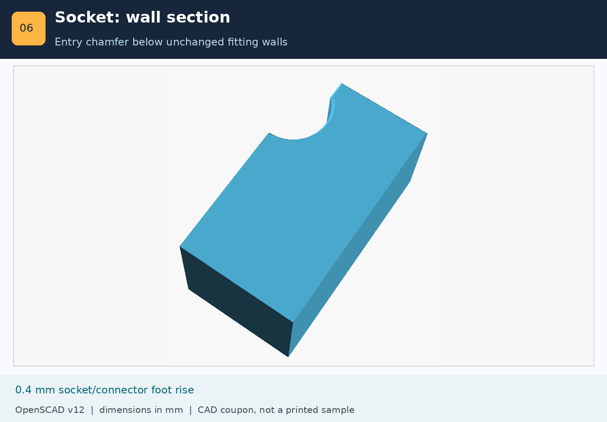
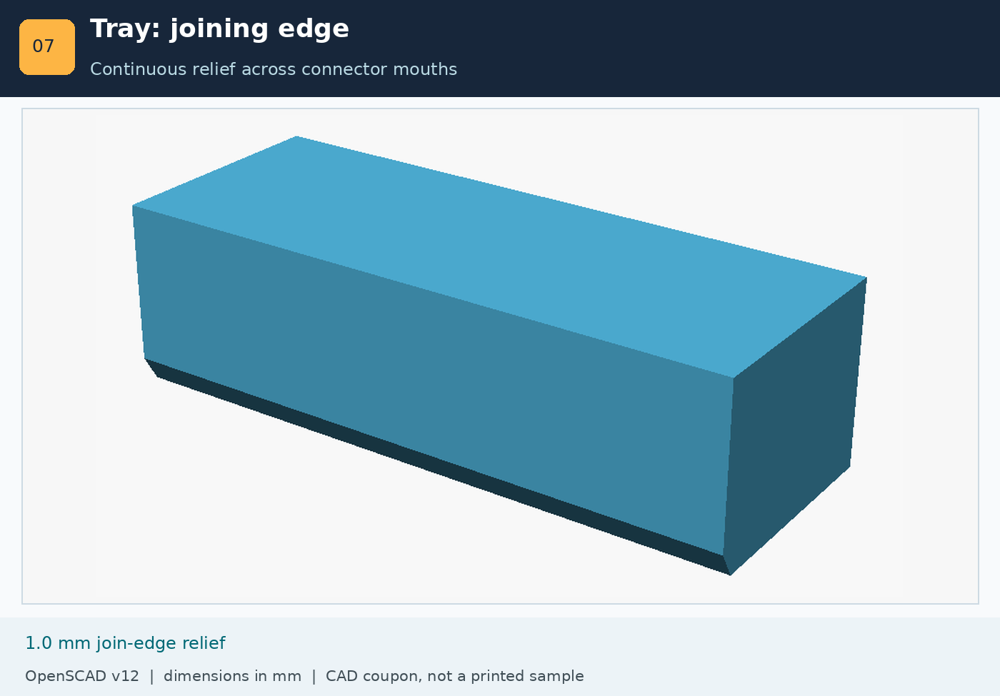
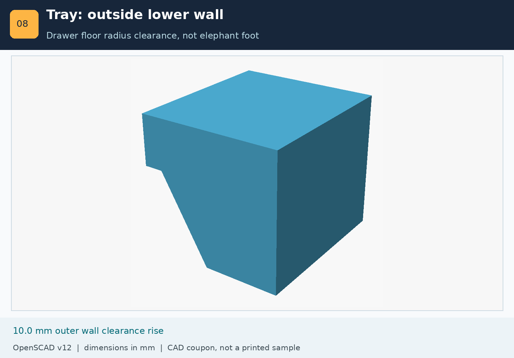

# Drawer Organizer — OpenSCAD v12

Parametric tray geometry for a measured, metal-sided drawer. Separate printed trays connect through removable dogbone pieces inserted into blind sockets from underneath. All dimensions below are millimetres unless stated otherwise. This README is a reference for the supplied Customizer preset, geometry rules, exporting, and verification.

**Files:** [Model](drawer-organizer-v12.scad) · [Matching Customizer preset](drawer-organizer-v12.json) · [Development and regression requirements](DEVELOPMENT.md)

## Print and export

1. Keep `drawer-organizer-v12.scad` and `drawer-organizer-v12.json` together. Open the SCAD file in OpenSCAD 2021.01 or later.
2. Select the **Kitchen cutlery drawer** preset and change the drawer/grid dimensions to match the actual drawer.
3. Set **Output mode** to **Selected tray** (`1`). Select row and column, press **F6**, and export its STL. A continued row belongs to the group started above it; selecting that row exports the complete grouped tray.
4. Repeat for each physical tray. Set **Output mode** to **Loose dogbone connectors** (`2`) to export the connectors. **Full layout** (`0`) is an inspection view, not a single print job.
5. Print the trays and connectors with their bottoms on the build plate. Insert dogbones upward into neighboring underside sockets after printing. The connectors are removable; no locking undercuts are modeled.

The 0.4 mm modeled connector foot relief and the 1.0 mm joining-edge relief are included in exported STL geometry. To evaluate the intended geometry, start with slicer elephant-foot compensation **off** and test-fit a single connector/socket pair. Physical printer variation is not measured by the model.

## Default configuration

| Parameter | v12 preset | Interpretation |
| --- | ---: | --- |
| Drawer top width / nominal floor width | 218 / 190 | Measured drawer dimensions; 1 mm total clearance is subtracted |
| Drawer inside length / rim height | 475 / 65 | Drawer length and height to rim |
| Grid | 3 columns × 6 rows | Row 1 is rear; column 1 is left as viewed from the drawer front |
| Row starts | 1, continued, 3, continued, continued, 1 | Five trays: rear full width, three middle, front full width |
| Floor / wall thickness | 2 / 2 | Nominal base and divider stock |
| **Inner bottom radius** | **20 mm** | Requested shared concave floor-to-wall fillet; changed from automatic in v11 |
| Inner bottom radius = 0 | automatic | Structural minimum, **12 mm** for this preset (10 mm exterior chamfer rise + 2 mm stock) |
| Soft exposed-edge radius | 0.6 | Top wall and accessible cutout edge treatment |
| Print overhang angle | 60° above build plate | Shared for exterior slopes, joining-edge relief and connector bevel |
| Drawer floor corner radius | 10 | Exterior lower sidewall clearance slope: 10 mm rise, ~5.77 mm horizontal run |
| Joining-edge elephant-foot relief | 1.0 | Rise along adjacent tray edges, including socket-mouth lips; ~0.58 mm horizontal run |
| Connector elephant-foot relief | 0.4 | Entry bevel around each socket and print-foot inset around each loose dogbone; ~0.23 mm horizontal run |
| Connector web width / lobe diameter | 4 / 6 | Two circular lobes joined by a straight web |
| Max male connector height | 6 | Actual head height can be shortened by the inner bottom fillet |
| Connector side clearance | 0.2 total | Female pocket 0.1 mm larger on each side |
| Connector top clearance | 1.0 | Female blind pocket roof clearance over the male |
| Default interior divider cutout | Row 4 enabled | Pre-rounding base width 25; rounding diameter 20; riser angle 75° |
| Loose connector count in preview/export | 8 | Full-layout inspection and connector-only output |

At the default preset, nominal floor width after clearance is 189 mm, and usable drawer length before tray-edge wall/fillet losses is 474 mm. Logical cell pitch is 63 × 79 mm. Actual clear floor area is reduced by the walls and circular bottom fillets.

## Build-plate contact geometry — magnified CAD screenshots

The eight screenshots below are generated from the v12 OpenSCAD geometry by [the inspection generator](scripts/chamfer_docs.py). Only the *surrounding material* is shortened to expose each interface; the actual connector/socket and chamfer calculations are reused. Views 04–06 show underside pockets with the face oriented toward the camera. Images are CAD previews, not photos or slicer toolpaths.

[Open the eight-view contact sheet](docs/images/inspection-contact-sheet.png) · [Cross-section dimensions (schematic)](docs/images/inspection-section-dimensions.png)

| Contact geometry | Close-up |
| --- | --- |
| **01. Loose connector — entire print foot**: round lobes and straight center web |  |
| **02. Loose connector — circular lobe**: 0.4 mm chamfer around round head |  |
| **03. Loose connector — straight web**: bottom-only relief along both narrow sides |  |
| **04. Socket — underside opening**: the flared entry begins at Z=0 |  |
| **05. Socket — round lobe and short mouth lips**: 0.4 mm entry relief plus adjoining tray-edge cut |  |
| **06. Socket — half-wall section**: the entry changes, but the blind roof and upper fitting walls do not |  |
| **07. Tray joining edge**: 1 mm rise; continuous across socket mouths |  |
| **08. Exterior bottom sidewall**: 10 mm drawer-floor clearance slope; not the connector elephant-foot feature |  |

The rise and run for the modeled foot relief are related by `horizontal_run = vertical_rise / tan(Print_overhang_angle_deg)`. Connector relief can be set to zero independently of the joining-edge relief. When necessary the connector chamfer is limited to retain stock around the dogbone web and the protected blind socket roof; the OpenSCAD echo reports its effective height and run.

## Geometry and fit rules

- **Plan and grouping.** Row 1 is farthest from the user (rear). A `Continue previous` row enlarges the tray immediately behind it rather than adding another seam. Column 1 is left when facing the open drawer.
- **Exterior walls.** Left/right outer walls widen with drawer height and can flare above the rim. Front/rear ends are vertical below their optional rim flare. The floor-to-side chamfer derives from the metal drawer's specified lower radius. An impossible exterior fit is rejected with an echo rather than clipped.
- **Inside fillet.** v12 requests a 20 mm concave inside floor-to-wall radius by default. The effective fillet is the larger of the entered value and its structural minimum. Enter **0** for automatic minimum. Adjacent rounds may meet in a shallow valley rather than leaving a horizontal flat area.
- **Connector outline.** Each loose dogbone has two circular 6 mm-diameter heads and a 4 mm web. Nominal straight span between lobe intersections is 4 mm at 2 mm tray wall thickness. Male connector upper height follows the same calculated interior fillet as the protected female socket roof, at a different constant radial offset.
- **Socket position.** All true joining edges receive sockets when connectors are enabled. Their stations are computed from available seam length and connector spacing. The pockets are blind and open on the underside only.
- **Clearances.** Side and top tolerances change the female pocket, not the male's upper fitting dimensions. The separate first-layer chamfer changes only the socket entrance and the loose piece's build-plate edge; it does not add a locking taper.
- **Cutout geometry.** Optional cutouts affect internal divider walls only. The 25 mm setting is the *unrounded* gap at the theoretical floor/riser intersection; tangent 10 mm-radius transitions are added. The cutout floor stays above the protected inner fillet and blind socket roofs.

## Reproduce and verify

Run from the repository root after installing OpenSCAD, Python 3, and the packages in `requirements-dev.txt`:

```sh
python -m pip install -r requirements-dev.txt
make check
python -m scripts.readme_gallery --input build/previews --output docs/images
python -m scripts.chamfer_docs --output docs/images
```

`make check` runs the pytest geometry tests and exports the tray STLs plus standard previews. The inspection generator creates `docs/images/inspection-01.png` through `inspection-08.png`, the contact sheet, and a separate schematic. The main-branch GitHub Actions workflow runs these checks, uploads artifacts, and commits regenerated reference images if they changed.

Tests cover OpenSCAD F5/F6 output, watertight individual tray/connector meshes, multiple inner radii, connector clearance envelopes, tray selections, cutout geometry and parameter bounds. Passing these tests does **not** establish actual first-layer printer behavior or connector fit; those need printed samples.

## Version history

- **v12:** default requested inside bottom radius changed to 20 mm (0 remains automatic); shallow connector/socket first-layer chamfers added, including joining-edge mouth lips; technical reference screenshots and documentation.
- **v11:** prior release, retrievable from Git history. Only the current v12 SCAD/JSON pair is retained in the repository root.
