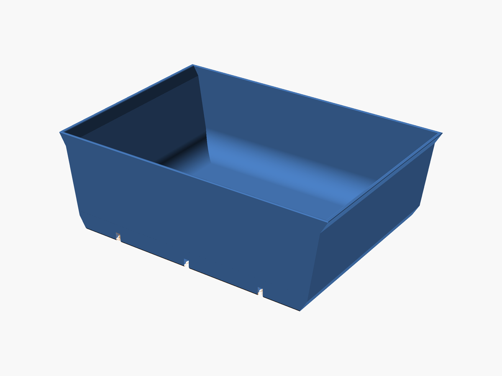
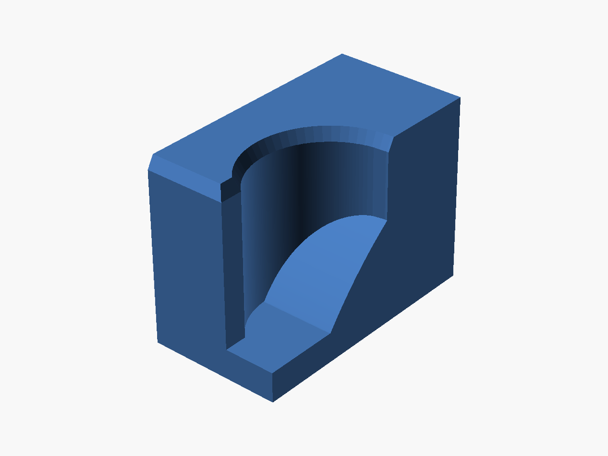

# Drawer Organizer — OpenSCAD v12

Parametric tray geometry for a measured, metal-sided drawer. Separate printed trays connect through removable dogbone pieces inserted into blind sockets from underneath. All dimensions below are millimetres unless stated otherwise. This README is a reference for the supplied Customizer preset, geometry rules, exporting, and verification.

**Files:** [Model](drawer-organizer-v12.scad) · [Matching Customizer preset](drawer-organizer-v12.json) · [Development and regression requirements](DEVELOPMENT.md)

## OpenSCAD gallery — actual model and print interfaces

These are **OpenSCAD previews from v12 geometry**, not photos or slicer results. The top rows show the actual supplied preset; the magnified connector/socket views use isolated CAD inspection crops and shortened surrounding stock while reusing the real connector and socket geometry. All gallery images use the same 4:3 frame and are paired with the relevant technical setting, following the Rocket Stove README format.

### Assembly and individual trays

| Complete five-tray layout | Full-width rear tray |
| --- | --- |
|  |  |
| `Output_mode=0`; 3 × 6 logical grid, five separate physical trays | `Output_mode=1`, row 1: full-width rear section |

| Middle tray with dividers | Full-width front tray |
| --- | --- |
|  |  |
| Selected middle section from row 3; 20 mm inner bottom radius | Selected front section from row 6, printed independently |

| Interior divider access cutout | Loose connector output |
| --- | --- |
|  |  |
| Row-4 access cutout, rounded 20 mm transition diameter | `Output_mode=2`; one dogbone shown for inspection |

### Loose dogbone — footprint and first layers

| Complete connector — angled foot | Top-down connector footprint |
| --- | --- |
|  |  |
| Both round lobes joined by a straight 4 mm web | 6 mm nominal lobe diameter; no locking undercuts |

| Circular lobe — sectioned detail | Straight web — isolated section |
| --- | --- |
|  |  |
| Rounded head locally sectioned to expose its 0.4 mm foot relief | Center web locally sectioned to expose both straight foot edges |

| Connector underside | Connector side profile |
| --- | --- |
|  |  |
| Bottom-facing view of the reduced first-layer footprint | Full fitting profile resumes above the 0.4 mm relief |

### Blind underside socket — mouth and section

| Underside socket entrance | Entrance viewed straight on |
| --- | --- |
|  |  |
| Female pocket opens at `Z=0` underneath the tray | Lobe and web entry are part of one blind socket |

| Lobe and joining-edge lips | Solid section through socket wall |
| --- | --- |
|  |  |
| 0.4 mm entrance chamfer and separate 1 mm joining-edge relief | The roof remains blind; upper fitting walls are not tapered |

### Tray joining edge — first-layer relief

| Joining-edge foot profile | Edge relief at a socket mouth |
| --- | --- |
|  |  |
| `Join_edge_elephant_foot_mm=1.0`, with ~0.58 mm run at 60° | Relief continues across the short lips beside the pocket |

The larger 10 mm exterior-floor clearance slope is a separate feature, **not** an elephant-foot close-up; the misleading former exterior-wall coupon is intentionally excluded. [Foot-relief dimensions (schematic, not to scale)](docs/images/inspection-section-dimensions.png).

## Print and export

1. Keep `drawer-organizer-v12.scad` and `drawer-organizer-v12.json` together. Open the SCAD file in OpenSCAD 2021.01 or later.
2. Select the **Kitchen cutlery drawer** preset and change the drawer/grid dimensions to match the actual drawer.
3. Set **Output mode** to **Selected tray** (`1`). Select row and column, press **F6**, and export its STL. A continued row belongs to the group started above it; selecting that row exports the complete grouped tray.
4. Repeat for each physical tray. Set **Output mode** to **Loose dogbone connectors** (`2`) to export the connectors. **Full layout** (`0`) is an inspection view, not a single print job.
5. Print the trays and connectors with their bottoms on the build plate. Insert dogbones upward into neighboring underside sockets after printing. The connectors are removable; no locking undercuts are modeled.

The 0.4 mm modeled connector foot relief and the 1.0 mm joining-edge relief are included in exported STL geometry. To evaluate the intended geometry, start with slicer elephant-foot compensation **off** and test-fit a single connector/socket pair. Physical printer variation is not measured by the model.

## Default configuration

| Parameter | v12 preset | Interpretation |
| --- | ---: | --- |
| Drawer top width / nominal floor width | 218 / 190 | Measured drawer dimensions; 1 mm total clearance is subtracted |
| Drawer inside length / rim height | 475 / 65 | Drawer length and height to rim |
| Grid | 3 columns × 6 rows | Row 1 is rear; column 1 is left as viewed from the drawer front |
| Row starts | 1, continued, 3, continued, continued, 1 | Five trays: rear full width, three middle, front full width |
| Floor / wall thickness | 2 / 2 | Nominal base and divider stock |
| **Inner bottom radius** | **20 mm** | Requested shared concave floor-to-wall fillet; changed from automatic in v11 |
| Inner bottom radius = 0 | automatic | Structural minimum, **12 mm** for this preset (10 mm exterior chamfer rise + 2 mm stock) |
| Soft exposed-edge radius | 0.6 | Top wall and accessible cutout edge treatment |
| Print overhang angle | 60° above build plate | Shared for exterior slopes, joining-edge relief and connector bevel |
| Drawer floor corner radius | 10 | Exterior lower sidewall clearance slope: 10 mm rise, ~5.77 mm horizontal run |
| Joining-edge elephant-foot relief | 1.0 | Rise along adjacent tray edges, including socket-mouth lips; ~0.58 mm horizontal run |
| Connector elephant-foot relief | 0.4 | Entry bevel around each socket and print-foot inset around each loose dogbone; ~0.23 mm horizontal run |
| Connector web width / lobe diameter | 4 / 6 | Two circular lobes joined by a straight web |
| Max male connector height | 6 | Actual head height can be shortened by the inner bottom fillet |
| Connector side clearance | 0.2 total | Female pocket 0.1 mm larger on each side |
| Connector top clearance | 1.0 | Female blind pocket roof clearance over the male |
| Default interior divider cutout | Row 4 enabled | Pre-rounding base width 25; rounding diameter 20; riser angle 75° |
| Loose connector count in preview/export | 8 | Full-layout inspection and connector-only output |

At the default preset, nominal floor width after clearance is 189 mm, and usable drawer length before tray-edge wall/fillet losses is 474 mm. Logical cell pitch is 63 × 79 mm. Actual clear floor area is reduced by the walls and circular bottom fillets.

## Geometry and fit rules

- **Plan and grouping.** Row 1 is farthest from the user (rear). A `Continue previous` row enlarges the tray immediately behind it rather than adding another seam. Column 1 is left when facing the open drawer.
- **Exterior walls.** Left/right outer walls widen with drawer height and can flare above the rim. Front/rear ends are vertical below their optional rim flare. The floor-to-side chamfer derives from the metal drawer's specified lower radius. An impossible exterior fit is rejected with an echo rather than clipped.
- **Inside fillet.** v12 requests a 20 mm concave inside floor-to-wall radius by default. The effective fillet is the larger of the entered value and its structural minimum. Enter **0** for automatic minimum. Adjacent rounds may meet in a shallow valley rather than leaving a horizontal flat area.
- **Connector outline.** Each loose dogbone has two circular 6 mm-diameter heads and a 4 mm web. Nominal straight span between lobe intersections is 4 mm at 2 mm tray wall thickness. Male connector upper height follows the same calculated interior fillet as the protected female socket roof, at a different constant radial offset.
- **Socket position.** All true joining edges receive sockets when connectors are enabled. Their stations are computed from available seam length and connector spacing. The pockets are blind and open on the underside only.
- **Clearances.** Side and top tolerances change the female pocket, not the male's upper fitting dimensions. The separate first-layer chamfer changes only the socket entrance and the loose piece's build-plate edge; it does not add a locking taper.
- **Cutout geometry.** Optional cutouts affect internal divider walls only. The 25 mm setting is the *unrounded* gap at the theoretical floor/riser intersection; tangent 10 mm-radius transitions are added. The cutout floor stays above the protected inner fillet and blind socket roofs.

## Reproduce and verify

Run from the repository root after installing OpenSCAD, Python 3, and the packages in `requirements-dev.txt`:

```sh
python -m pip install -r requirements-dev.txt
make check
python -m scripts.readme_gallery --input build/previews --output docs/images
python -m scripts.chamfer_docs --output docs/images
```

`make check` runs the pytest geometry tests and exports the tray STLs plus standard previews. The inspection generator publishes **18 equally sized, unnumbered CAD images** in `docs/images/cad/` (six actual-preset overview/detail views and twelve connector/socket/joining-edge views), plus the linked section schematic. GitHub Actions regenerates and publishes the gallery from the same v12 geometry.

Tests cover OpenSCAD F5/F6 output, watertight individual tray/connector meshes, multiple inner radii, connector clearance envelopes, tray selections, cutout geometry and parameter bounds. Passing these tests does **not** establish actual first-layer printer behavior or connector fit; those need printed samples.

## Version history

- **v12:** default requested inside bottom radius changed to 20 mm (0 remains automatic); shallow connector/socket first-layer chamfers added, including joining-edge mouth lips; technical reference screenshots and documentation.
- **v11:** prior release, retrievable from Git history. Only the current v12 SCAD/JSON pair is retained in the repository root.
